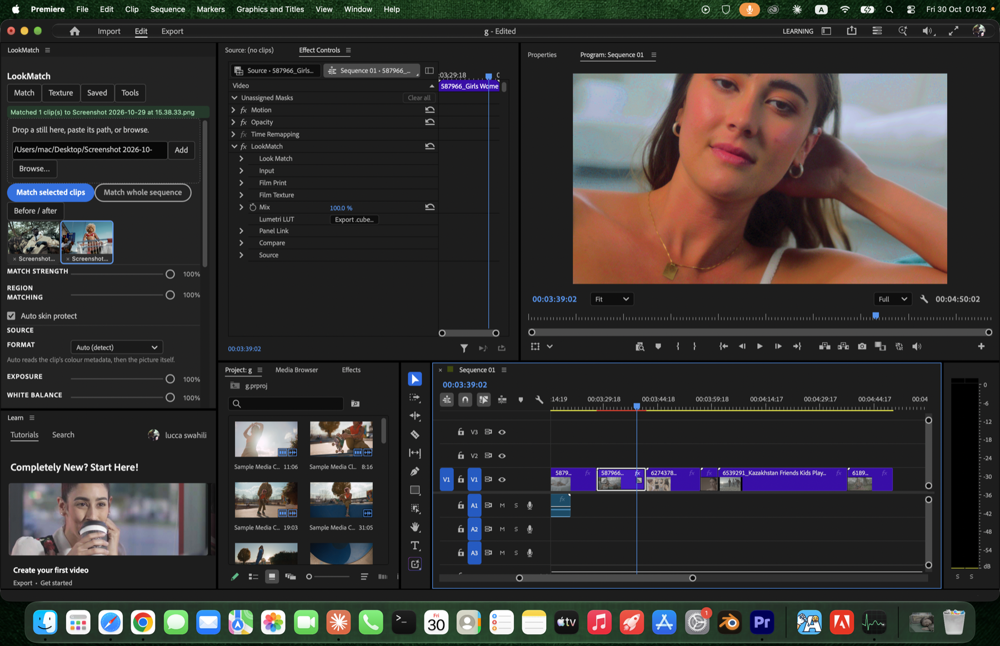
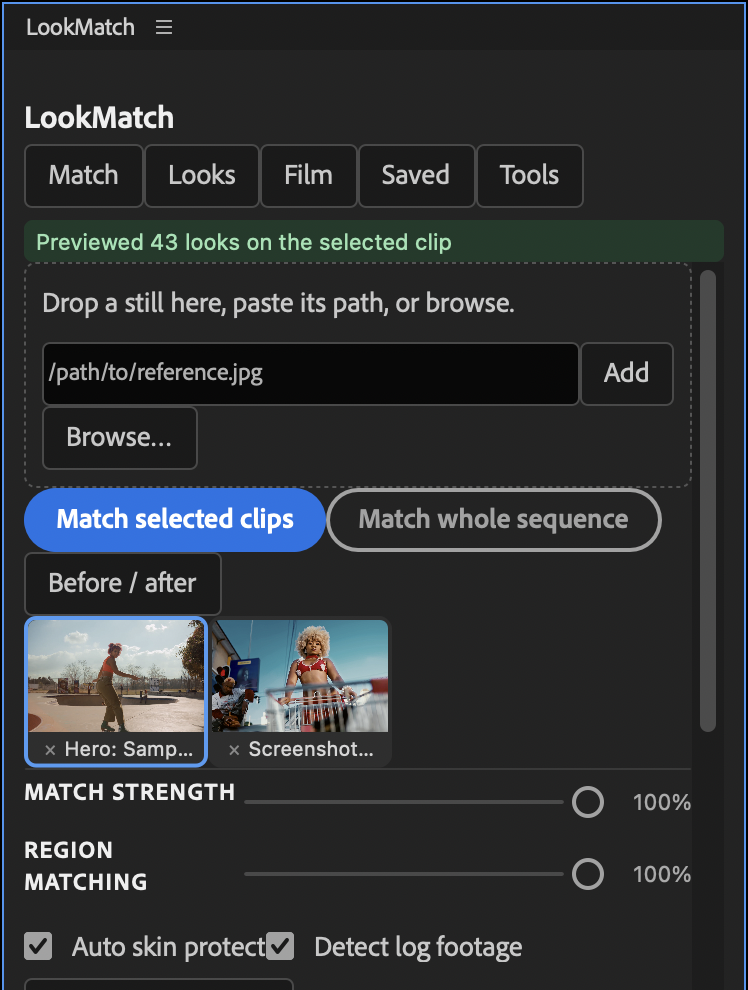
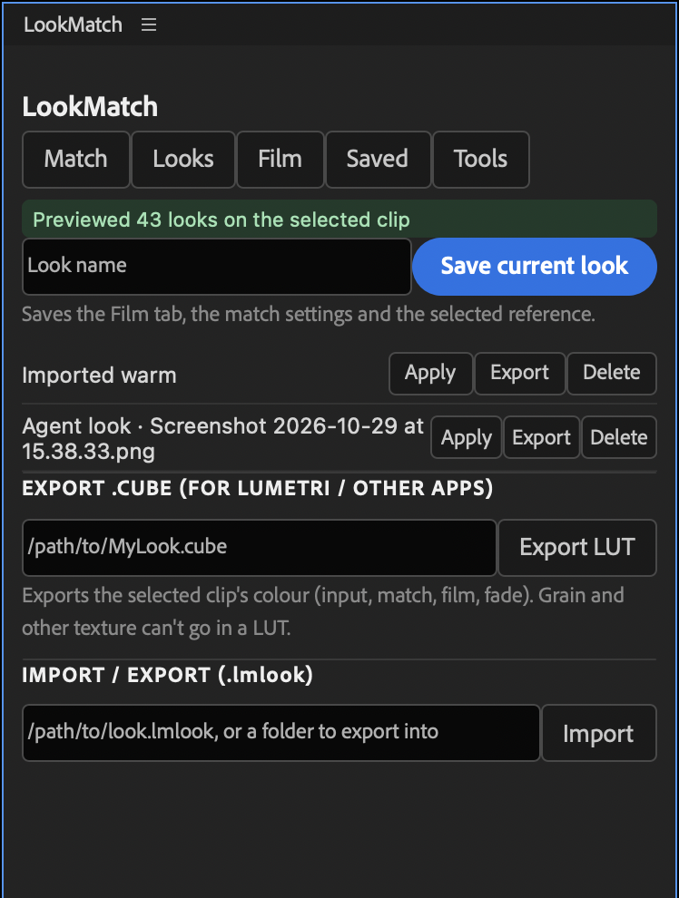
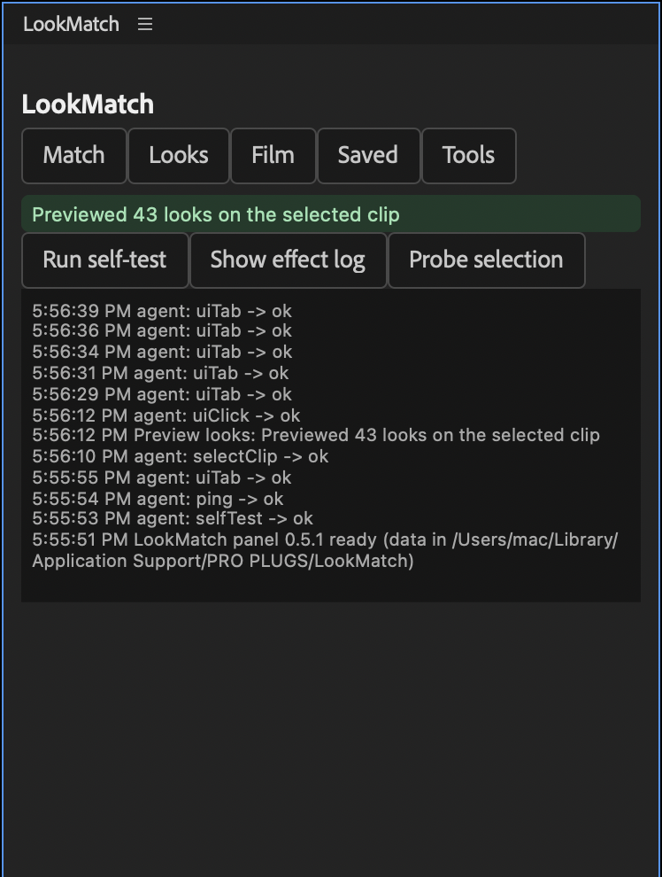

# LookMatch panel (Premiere Pro 2025 and later)

The LookMatch panel is a dockable window that drives the LookMatch effect. Use it to match clips to a
reference, adjust the texture controls, and save looks. The effect still does all the
rendering. The panel sets its controls, and adds LookMatch to a clip when it's missing.



Open it with **Window > UXP Plugins > LookMatch** (some versions: **Window > Extensions > LookMatch**).
Every change the panel makes is one undo step (Edit > Undo).

## Match



1. Add reference stills to the library: drop an image on the dashed box, paste its path and click **Add**, or
   **Browse…**. The library is kept between sessions.
2. Click a thumbnail to choose it, select clips on the timeline and click **Match selected clips** (or **Match whole
   sequence**). Each clip is matched from its own frame the first time Premiere draws it, so park the playhead on
   it or play over it.
3. **Match strength**, **Region matching** and **Auto skin protect** set how hard the match pulls. **Apply strength
   only** changes the strength of clips that are already matched.
4. **Before / after** turns on a split view in the Program monitor (original on the left). **Split position** moves
   the line.

### Source

The match is source-aware. Before the reference's look goes on, each clip is read and brought to one canonical
state, so the result depends on what is in the shot, not on how it was shot or graded before. See
[MATCHING.md](MATCHING.md) for how it works and how consistent it is.

- **Format**: how the clip's code values are encoded. **Auto** uses the clip's colour metadata (colour space,
  input LUT, file name) when it names a curve, and otherwise detects log or display footage from the picture
  (raised black floor, highlights short of the top codes, low contrast and saturation). Pick a format to override:
  Rec.709, sRGB, S-Log3, LogC3, LogC4, Canon Log 3, V-Log, F-Log, F-Log2, Apple Log, Blackmagic Film Gen5,
  RED Log3G10 or DJI D-Log. A detected log clip is decoded with S-Log3 unless metadata or the override says which
  curve it is: from the picture alone the curves can't be told apart. Matching sets **Footage Encoding** to
  Rec.709, as the match now decodes the footage itself.
- **Exposure**, **White balance**, **Contrast**: how much of the clip's own exposure, white balance (temperature and
  tint) and contrast/saturation to even out before the look. 100% gives the most consistent matches; lower keeps
  more of the clip's own character.
- **Look strength**: how much of the reference's look goes on top of the evened-out clip.
- **Match contrast**: how far the graded clip's blacks, shadows, mids, highlights and whites are brought to the
  reference's after the look, while keeping skin from being crushed. The default is 100%.

Artlist "LOG" clips (the file name has "Artlist" and "LOG") are decoded as Fujifilm F-Log on **Auto**. Artlist
re-exports them through Resolve, so the camera curve is lost, and F-Log fits them best. The analysis line says
"Artlist log → F-Log (best fit)". Pick another format to override it.

After **Match**, the panel shows each clip's analysis inline as soon as Premiere has drawn the clip once:

| | Before | After | Reference |
|---|---|---|---|
| Format | detected or chosen format | | |
| Exposure | stops from 18% grey | | |
| Temperature / Tint | white the clip was balanced for (K, tint; D65 = 6504 K / 0) | | |
| Contrast | stops between the 5th and 95th percentile of luminance | | |

**Deband.** Compressed 8- and 10-bit log footage stores smooth gradients such as skies as fine steps, and a grade
expands them into contour rings. So whenever the effect changes the picture, it smooths those steps first, on the
GPU and the CPU alike, and leaves edges and texture alone. Untouched clips pass through unchanged. See
[MATCHING.md](MATCHING.md#deband-contour-rings-in-skies).

A match never applies a film print: matching sets **Film Strength** to 0 (projects saved with an earlier build keep
their film settings until a clip is matched again).

**A look from several stills.** Cmd-click (or Shift-click) more references to select 2–5 stills of one look,
for example frames from the same film or grade. Each still is read on its own, and the look's parts are combined
by median: tone levels, neutral axis, skin treatment and hue sectors. So the match depends less on what happens
to be in one still, and one odd still moves it little. In `reference_tests`, three stills moved the match 36% less
than one, and an odd still of another grade moved a three-still look 1.79 ΔEok with the median combine, against
2.28 with the stills' pixels pooled. A plain click selects a single reference again.

**Shot matching.** Select your best-looking clip, park the playhead on it, and click **Use selected clip as
reference**. Its frame joins the library as "Hero: …". Then match other clips to it, or use **Match sequence to
this clip** to do both steps at once: every clip except the hero is matched, and the hero keeps its own grade.
With **Match to its graded look** (on by default), the hero's frame is captured as LookMatch renders it, match
included. The other clips then take the hero's finished look, so exposure, white balance and skin agree across
cuts. This matters most when the hero was matched with its own settings or references. Turn it off to use the
hero's frame as shot.

A match made from the panel is kept on this Mac (in the LookMatch data folder). To store it inside the project,
for example to open the project on another Mac, click **Effect Controls > LookMatch > Panel Link > Save into Project**.

## Texture

This tab has the film texture controls of the effect: fade, halation, bloom, grain, softness, vignette, gate weave
and flicker. **Read from selected clip** loads a clip's settings, and **Apply to selected clips** / **Apply to
sequence** writes them. (The film print controls, negative and print stocks and printer lights, are no longer in the
panel. The effect keeps them so older projects load unchanged.)

## Saved



- **Save current look** stores the Texture tab, the match and source settings and the chosen reference under a name.
  **Apply** re-applies everything, including matching to the saved reference.
- **Export LUT** writes the selected clip's colour (input, match, fade) as a 65³ `.cube`. Use it in Lumetri
  or other apps. Texture such as grain can't be stored in a LUT.
- **Import / Export (.lmlook)** shares looks between machines. A `.lmlook` file is a small JSON file with the
  control values.

## Tools



- **Run self-test** checks the panel against the selected clip, then restores the clip's settings.
- **Show effect log** prints the effect's diagnostic log, if Premiere was started with `LOOKMATCH_LOG=1`.
- **Probe selection** lists the selected clips and their LookMatch settings.

## Where things are kept

`~/Library/Application Support/PRO PLUGS/LookMatch/` (Windows: `%APPDATA%\PRO PLUGS\LookMatch\`)

| File | Contents |
|---|---|
| `library.json` | References and saved looks |
| `refs/<n>.txt`, `refs/<n>.lut` | A panel match: the reference path and the built LUT (`n` = the clip's Reference Slot) |
| `refs/<n>.json` | That match's analysis: source, reference and result (format, exposure, temperature, tint, contrast) |
| `refs/capture-<n>.png` | Hero clip frames |
| `panel.log` | The Tools console, for troubleshooting |

## How the panel talks to the effect

Premiere doesn't let a panel pass text to an effect, and doesn't tell an effect when a panel changes one of its
controls. So the effect has a collapsed **Panel Link** group of number controls:

- **Reference Slot.** The panel writes the reference path to `refs/<slot>.txt` and sets the slot. The effect
  notices the new slot on its next render, builds the match from that frame, and caches it as `refs/<slot>.lut`
  for every render thread, with its analysis in `refs/<slot>.json`. (**Thumbs Slot** is left over from the
  film look previews, which are gone.)
- **LUT Export Slot** and **Capture Slot** work the same way. The effect answers in
  `refs/<kind>-<slot>.done`, and the panel waits for that file.
- **Save into Project** (a button) copies the panel's match into the hidden Match Data control, which is saved
  in the project.

The effect never builds a match from Premiere's yellow "Media pending" card, which shows while footage is still loading.

## Known limits

- **Panel matches live on this Mac** until you click **Panel Link > Save into Project** in Effect Controls. A panel
  can't press an effect's button.
- **A clip is matched the first time Premiere draws it** (playhead over it, playback or export). Matching a whole
  sequence doesn't render every clip up front.
- **GPU rendering covers the colour path.** With the Premiere Pro SDK, LookMatch renders on the GPU (Metal):
  colour (match, film, fade), grain, vignette, mix and split view. Log footage matched through **Source > Format**
  renders on the GPU too, as the match decodes it. Clips using halation, bloom, softness, gate weave, flicker, or a
  log **Footage Encoding**, render on the CPU automatically. See *GPU rendering* in the README.
- **Windows** builds (effect and panel) are written to be portable but are untested.

## Building and installing (developers)

```bash
installer/mac/build_panel.sh --install            # dev build, installs with Adobe's UnifiedPluginInstallerAgent
installer/mac/build_panel.sh --release            # leaves out the test agent and tests
node src/panel-uxp/test/run.js                    # panel unit tests (mocked premierepro)
```

Dev builds include a test agent (`lib/agent.js`). It runs only while `<data>/agent/enabled` exists, and accepts
a fixed list of commands from `<data>/agent/cmd.json` (`tools/panel_agent.py` sends them). It's how the panel
was tested inside Premiere. `tools/restart_premiere.sh` saves the project through the agent, confirms the save,
and only then quits Premiere to install a new effect build.
