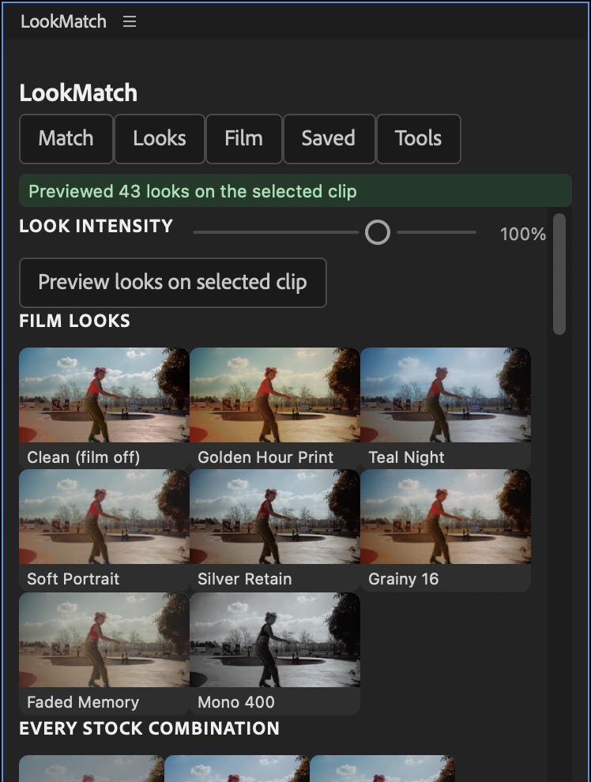
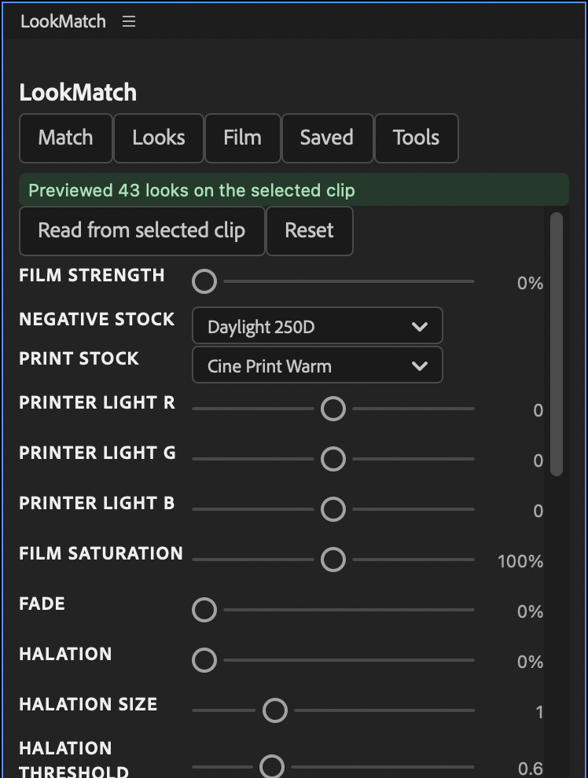

# LookMatch panel (Premiere Pro 2025 and later)

The LookMatch panel is a dockable window that drives the LookMatch effect. Use it to match clips to a
reference, try film looks, adjust the film controls, and save looks. The effect still does all the
rendering. The panel sets its controls, and adds LookMatch to a clip when it's missing.


Open it with **Window > UXP Plugins > LookMatch** (some versions: **Window > Extensions > LookMatch**).
Every change the panel makes is one undo step (Edit > Undo).

## Match


1. Add reference stills to the library: drop an image on the dashed box, paste its path and click **Add**, or
   **Browse…**. The library is kept between sessions.
2. Click a thumbnail to choose it, select clips on the timeline and click **Match selected clips** (or **Match whole
   sequence**). Each clip is matched from its own frame the first time Premiere draws it, so park the playhead on
   it or play over it.
3. **Match strength**, **Region matching** and **Auto skin protect** set how hard the match pulls. **Apply strength
   only** changes the strength of clips that are already matched.
4. **Detect log footage** sets Footage Encoding from the clip name (S-Log3, LogC, V-Log). Otherwise Rec.709 is assumed.
5. **Before / after** turns on a split view in the Program monitor (original on the left). **Split position** moves
   the line.

**Shot matching.** Select your best-looking clip, park the playhead on it, and click **Use selected clip as
reference**. Its frame (without LookMatch's grade) joins the library as "Hero: …". Then match other clips to it,
or use **Match sequence to this clip** to do both steps at once.

A match made from the panel is kept on this Mac (in the LookMatch data folder). To store it inside the project,
for example to open the project on another Mac, click **Effect Controls > LookMatch > Panel Link > Save into Project**.

## Looks



Click a look to apply it to the selected clips. **Look intensity** (0–150%) scales how far each look moves the
controls from neutral. **Preview looks on selected clip** renders the clip's current frame, including its match,
through every look, so the cards show your own shot.

The 8 film looks:

| Look | What it does |
|---|---|
| Clean | Film emulation off |
| Golden Hour Print | Daylight negative on a warm print, printed warm, soft halation |
| Teal Night | Night 800T negative on a cool print, strong halation and bloom |
| Soft Portrait | Portrait negative, low-contrast print, gentle fade and softness |
| Silver Retain | Desaturated, high-contrast print |
| Grainy 16 | Heavy grain, halation, softness, gate weave and flicker |
| Faded Memory | Lifted blacks, low saturation, warm fade |
| Mono 400 | Black-and-white negative |

Below them are cards for **every negative × print combination**. The looks were checked offline with the engine:
see [looks-contact-sheet.png](looks-contact-sheet.png).

Printer lights work like a film lab's. Raising a colour's light removes that colour from the print: +R is more
cyan and +B is more yellow, so warm looks use −R / +B.

## Film



This tab has every film and texture control of the effect. **Read from selected clip** loads a clip's settings,
and **Apply to selected clips** / **Apply to sequence** writes them.

## Saved


- **Save current look** stores the Film tab, the match settings and the chosen reference under a name.
  **Apply** re-applies everything, including matching to the saved reference.
- **Export LUT** writes the selected clip's colour (input, match, film, fade) as a 65³ `.cube`. Use it in Lumetri
  or other apps. Texture such as grain can't be stored in a LUT.
- **Import / Export (.lmlook)** shares looks between machines. A `.lmlook` file is a small JSON file with the
  control values.

## Tools


- **Run self-test** checks the panel against the selected clip, then restores the clip's settings.
- **Show effect log** prints the effect's diagnostic log, if Premiere was started with `LOOKMATCH_LOG=1`.
- **Probe selection** lists the selected clips and their LookMatch settings.

## Where things are kept

`~/Library/Application Support/PRO PLUGS/LookMatch/` (Windows: `%APPDATA%\PRO PLUGS\LookMatch\`)

| File | Contents |
|---|---|
| `library.json` | References and saved looks |
| `refs/<n>.txt`, `refs/<n>.lut` | A panel match: the reference path and the built LUT (`n` = the clip's Reference Slot) |
| `refs/capture-<n>.png` | Hero clip frames |
| `refs/thumbs-<n>-<look>.png` | Look previews |
| `panel.log` | The Tools console, for troubleshooting |

## How the panel talks to the effect

Premiere doesn't let a panel pass text to an effect, and doesn't tell an effect when a panel changes one of its
controls. So the effect has a collapsed **Panel Link** group of number controls:

- **Reference Slot.** The panel writes the reference path to `refs/<slot>.txt` and sets the slot. The effect
  notices the new slot on its next render, builds the match from that frame, and caches it as `refs/<slot>.lut`
  for every render thread.
- **LUT Export Slot**, **Capture Slot** and **Thumbs Slot** work the same way. The effect answers in
  `refs/<kind>-<slot>.done`, and the panel waits for that file.
- **Save into Project** (a button) copies the panel's match into the hidden Match Data control, which is saved
  in the project.

The effect never builds a match from Premiere's yellow "Media pending" card, which shows while footage is still loading.

## Known limits

- **Panel matches live on this Mac** until you click **Panel Link > Save into Project** in Effect Controls. A panel
  can't press an effect's button.
- **A clip is matched the first time Premiere draws it** (playhead over it, playback or export). Matching a whole
  sequence doesn't render every clip up front.
- **GPU rendering covers the colour path.** With the Premiere Pro SDK, LookMatch renders on the GPU (Metal):
  colour (match, film, fade), grain, vignette, mix and split view, for Rec.709 footage. Clips using halation, bloom,
  softness, gate weave, flicker or log footage render on the CPU automatically. See *GPU rendering* in the README.
- **Windows** builds (effect and panel) are written to be portable but are untested.

## Building and installing (developers)

```bash
installer/mac/build_panel.sh --install            # dev build, installs with Adobe's UnifiedPluginInstallerAgent
installer/mac/build_panel.sh --release            # leaves out the test agent and tests
node src/panel-uxp/test/run.js                    # panel unit tests (mocked premierepro)
node tools/looks_sheet.js frame.png sheet.png --ref reference.jpg   # contact sheet of the looks
```

Dev builds include a test agent (`lib/agent.js`). It runs only while `<data>/agent/enabled` exists, and accepts
a fixed list of commands from `<data>/agent/cmd.json` (`tools/panel_agent.py` sends them). It's how the panel
was tested inside Premiere. `tools/restart_premiere.sh` saves the project through the agent, confirms the save,
and only then quits Premiere to install a new effect build.
